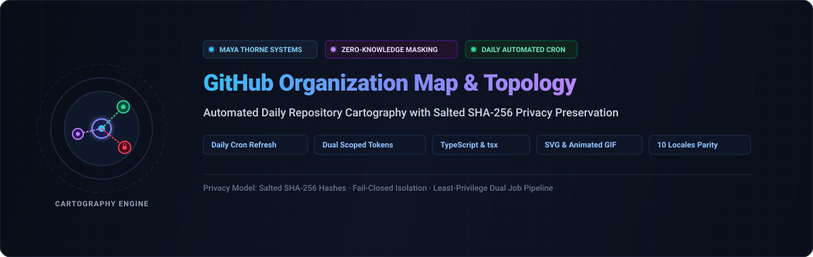
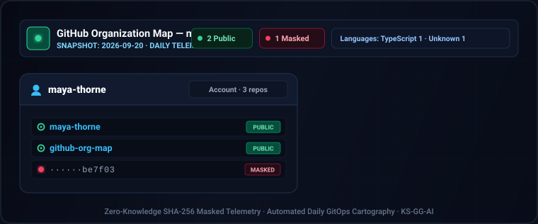
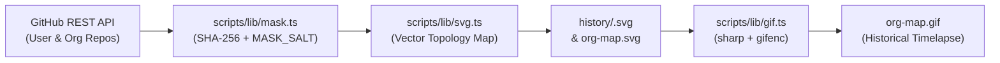

<div align="center">

<p align="center">
  <strong>🇺🇸 English</strong> ·
  <a href="./docs/locales/ko.md">🇰🇷 한국어</a> ·
  <a href="./docs/locales/zh-CN.md">🇨🇳 中文</a> ·
  <a href="./docs/locales/es.md">🇪🇸 Español</a> ·
  <a href="./docs/locales/hi.md">🇮🇳 हिन्दी</a><br />
  <a href="./docs/locales/ar.md">🇸🇦 العربية</a> ·
  <a href="./docs/locales/pt-BR.md">🇧🇷 Português</a> ·
  <a href="./docs/locales/ru.md">🇷🇺 Русский</a> ·
  <a href="./docs/locales/fr.md">🇫🇷 Français</a> ·
  <a href="./docs/locales/id.md">🇮🇩 Bahasa Indonesia</a>
</p>

<p align="center">
  <a href="https://github.com/maya-thorne/github-org-map">
    
  </a>
</p>

# 🗺️ github-org-map

<p align="center">
  <strong>Automated daily cartography and topology mapping of maya-thorne repositories with zero-knowledge SHA-256 privacy masking.</strong>
</p>

<p align="center">
  <a href="LICENSE"></a>
  <a href="https://github.com/maya-thorne/github-org-map/releases"></a>
  <a href="https://github.com/maya-thorne/github-org-map"></a>
  <a href="https://github.com/maya-thorne/github-org-map"></a>
  <a href="https://github.com/maya-thorne/github-org-map"></a>
  <a href="https://github.com/maya-thorne/github-org-map"></a>
</p>

<sub>Engineered &amp; Maintained by **[Maya Thorne](https://github.com/maya-thorne)** · Automated Systems Cartography &amp; Privacy-Preserving Topology</sub>

<br><br>

<p align="center">
  <a href="https://github.com/maya-thorne/github-org-map">
    
  </a>
</p>

</div>

---

## 📑 Table of Contents

- [📌 Executive Overview](#executive-overview)
- [📂 Repository Structure & Artifact Catalog](#repository-structure-catalog)
- [⚙️ How It Works & Architecture](#how-it-works-architecture)
- [🔒 Zero-Knowledge Privacy & SHA-256 Masking](#zero-knowledge-privacy)
- [🔑 Required Secrets & Token Isolation](#required-secrets-isolation)
- [⏱️ Dual-Job Workflow & Automation Schedule](#dual-job-workflow-schedule)
- [💻 Local Execution & Setup](#local-execution-setup)
- [🛠️ Configuration Reference](#configuration-reference)
- [🧪 Test Suite & Quality Verification](#test-suite-verification)
- [📜 License](#license)
- [📬 Contact & Profile](#contact-profile)

---

<span id="executive-overview"></span>
## 📌 Executive Overview

<details open>
<summary><b>🗺️ Expand Executive Overview &amp; Live Cartography Snapshot</b></summary>
<br>

**github-org-map** provides an automated, daily-refreshed visual cartography and topology diagram of all repositories owned by the `maya-thorne` account and the `maya-thorne` organization.

### 🎯 Key Design Capabilities
- **Zero-Knowledge Privacy Preservation**: Public repositories appear with their real names; private repositories are deterministically transformed into opaque masked labels via HMAC/SHA-256 with a secret salt (`MASK_SALT`).
- **Complete Timeline Archival**: Every daily snapshot is archived under [`history/<date>.svg`](./history/) and stitched into an animated visual GIF ([`org-map.gif`](./org-map.gif)) using `sharp` and `gifenc`.
- **Privilege-Separated CI/CD**: A GitHub Actions workflow splits generation (read-only token access) and committing (write access, zero credential exposure) into two isolated jobs to guarantee fail-closed credential isolation.
- **Root Clutter Mitigation**: All 16 primary project assets and artifacts are documented transparently below with clear demarcation of roles.



</details>

---

<span id="repository-structure-catalog"></span>
## 📂 Repository Structure & Artifact Catalog

<details open>
<summary><b>📦 Expand Repository Architecture &amp; File Catalog (16 Core Artifacts Documented)</b></summary>
<br>

To mitigate root clutter and provide immediate visual clarity on all 16 repository items, the table below documents the dedicated operational purpose of each directory and top-level file:

| <nobr>Category</nobr> | <nobr>Path / Artifact</nobr> | <nobr>Type</nobr> | <nobr>Primary Role &amp; Operational Mechanics</nobr> |
| :--- | :--- | :---: | :--- |
| **Automation** | [`.github/workflows/refresh.yml`](./.github/workflows/refresh.yml) | Workflow | **Dual-Job CI/CD Pipeline**: Runs daily at 00:00 UTC and on-demand via `workflow_dispatch`. Strictly separates secret-holding read operations (`generate`) from artifact-committing write operations (`commit`). |
| **Pipeline Logic** | [`scripts/generate.ts`](./scripts/generate.ts) | TypeScript | **Main Orchestration Entry Point**: Ingests repository lists, applies SHA-256 salt masking, generates today's SVG, archives to history, and invokes the GIF rendering pipeline. |
| **Pipeline Logic** | [`scripts/lib/github.ts`](./scripts/lib/github.ts) | TypeScript | **GitHub REST Client**: Communicates with the GitHub API using fine-grained scoped tokens (`USER_READ_TOKEN`, `ORG_READ_TOKEN`) with pagination and rate-limit guardrails. |
| **Pipeline Logic** | [`scripts/lib/mask.ts`](./scripts/lib/mask.ts) | TypeScript | **Zero-Knowledge Privacy Masker**: Implements deterministic SHA-256 salt hashing for private repos, exclusions for dot-prefixed repos, and collision validation. |
| **Pipeline Logic** | [`scripts/lib/svg.ts`](./scripts/lib/svg.ts) | TypeScript | **Vector Cartography Renderer**: Builds crisp SVG topology diagrams with custom styling, account/org badges, and grid positioning. |
| **Pipeline Logic** | [`scripts/lib/gif.ts`](./scripts/lib/gif.ts) | TypeScript | **Timelapse GIF Assembler**: Rasterizes historical daily SVGs via `sharp` and encodes optimal animated frames via `gifenc`. |
| **Pipeline Logic** | [`scripts/types/gifenc.d.ts`](./scripts/types/gifenc.d.ts) | Type Def | **Type Declarations**: TypeScript interface definitions for the `gifenc` encoder library. |
| **Configuration** | [`data/config.json`](./data/config.json) | JSON Config | **Cartography Config**: Governs tracked user/org logins, frame delays (`frameMs`, `lastFrameMs`, `maxFrames`), and token environment variable bindings. |
| **Historical Archive** | [`history/`](./history/) | Directory (21+ SVGs) | **Time-Series SVG Snapshots**: Preserves dated daily snapshots (`YYYY-MM-DD.svg`) used to reconstruct repository evolution over time. |
| **Documentation** | [`docs/`](./docs/) | Directory | **Multilingual Docs & Visual Assets**: Contains localized readmes (`docs/locales/` in 10 languages) and SVG banners/maps (`docs/assets/`). |
| **Testing Suite** | [`test/`](./test/) | Test Suite | **Node.js Native Test Suite**: Contains `mask.test.ts`, `github.test.ts`, and `generate.test.ts` (37 unit & integration tests). |
| **Generated Map** | [`org-map.svg`](./org-map.svg) | SVG Map | **Current Vector Topology Map**: The canonical vector representation of the latest repository structure, embedded in the README. |
| **Generated Map** | [`org-map.gif`](./org-map.gif) | Animated GIF | **Historical Timelapse Map**: Animated visualization assembled from historical snapshots showing organizational growth. |
| **Package Config** | [`package.json`](./package.json) | NPM Manifest | **Dependencies & Task Definitions**: Defines Node.js `>=20` engine requirements, scripts (`generate`, `typecheck`, `test`), and dependencies (`sharp`, `gifenc`, `tsx`). |
| **Package Lock** | [`package-lock.json`](./package-lock.json) | Lockfile | **Deterministic Dependency Lock**: Locks exact versions of transitive dependencies for repeatable CI runs. |
| **TypeScript Config**| [`tsconfig.json`](./tsconfig.json) | TS Config | **TypeScript Compiler Options**: Configures ES2022 module resolution, strict type-checking, and path mappings. |
| **Environment** | [`.env.example`](./.env.example) | Env Template | **Credential Template**: Illustrates required local environment variables (`USER_READ_TOKEN`, `ORG_READ_TOKEN`, `MASK_SALT`). |
| **Security Rule** | [`.gitignore`](./.gitignore) | Git Ignore | **Strict Leak Prevention**: Blocks environment tokens (`.env*`), AI agent memory (`memory/`, `.gemini/`), temp files (`*.tmp`), and OS clutter (`.DS_Store`, `Thumbs.db`). |
| **Legal** | [`LICENSE`](./LICENSE) | License | **Maya Thorne Systems & Security Research License (MT-SRL)**: Grants dual-use systems research and evaluation rights. |
| **Documentation** | [`README.md`](./README.md) | Markdown | **Master Cartography & Systems Guide**: Authoritative repository manual, architectural diagrams, zero-knowledge privacy specs, dual-job CI/CD workflows, and configuration references. |

</details>

---

<span id="how-it-works-architecture"></span>
## ⚙️ How It Works & Architecture

<details open>
<summary><b>🔍 Expand How It Works &amp; Pipeline Execution Details</b></summary>
<br>

This repository autonomously generates the organization map using a modular 5-phase data pipeline:

1. **Repository Ingestion**: Fetches repository metadata across target personal accounts and organizations using GitHub REST API v3.
2. **Zero-Knowledge Sanitization**:
   - Public repositories retain full public titles and descriptions.
   - Private repositories have titles deterministically hashed via `HMAC-SHA-256(repo_name, MASK_SALT)`, and descriptions/topics are stripped.
   - Internal/dot-prefixed repos or explicitly excluded hashes are omitted entirely.
3. **SVG Topology Rendering**: Calculates dynamic layout geometry, visual grouping, and typography, outputting today's vector map into `history/<YYYY-MM-DD>.svg` and mirroring to `org-map.svg`.
4. **Timelapse Compilation**: `scripts/lib/gif.ts` collects all historical SVGs in chronological order, converts them into high-fidelity bitmaps via `sharp`, and writes an animated GIF (`org-map.gif`) via `gifenc`.
5. **Isolated Two-Step Git Push**: The updated SVG and GIF artifacts are committed back to the repository via GitHub Actions.

</details>

---

<span id="zero-knowledge-privacy"></span>
## 🔒 Zero-Knowledge Privacy & SHA-256 Masking

<details open>
<summary><b>🛡️ Expand Zero-Knowledge Privacy &amp; Hashing Guarantees</b></summary>
<br>

To protect sensitive and pre-release repository titles while maintaining verifiable continuity:

- **Non-Reversible Labels**: Private repository names are never transmitted or written to disk in plain text.
- **Salted Determinism**: The label `masked-xxxxxx` is derived from:
  $$\text{Label} = \text{HMAC-SHA256}(\text{RepoName}, \text{MASK\_SALT})[0..6]$$
  Using the same salt guarantees that the same private repository retains the identical masked label across consecutive days, making trajectory tracking coherent without leaking plain text names.
- **Fail-Closed Security**: If `MASK_SALT` is missing, blank, or malformed, the pipeline throws an immediate fatal exception and aborts without writing partial or unprotected artifacts.
- **Defense in Depth**: Even if a private repository carries a detected language or topic tags, the sanitizer forcibly zeroes them out (`language: null`, `topics: []`).

</details>

---

<span id="required-secrets-isolation"></span>
## 🔑 Required Secrets & Token Isolation

<details open>
<summary><b>🔐 Expand Required Secrets &amp; Token Specifications</b></summary>
<br>

Because fine-grained GitHub Personal Access Tokens (PATs) are bounded to a single resource owner, reading both user-owned and organization-owned repositories requires dedicated credentials:

| Secret Name | Scope & Resource Owner | Permissions Required | Description |
| :--- | :--- | :--- | :--- |
| `USER_READ_TOKEN` | Personal Account (`maya-thorne`) | **All Repositories** &bull; **Metadata (Read-Only)** | Allows listing personal public and private repositories without granting write access. |
| `ORG_READ_TOKEN` | Target Organization | **All Repositories** &bull; **Metadata (Read-Only)** | Allows listing organization public and private repositories without granting write access. |
| `MASK_SALT` | Cryptographic Salt | High-entropy random string | Used to compute HMAC-SHA-256 hashes for private repositories. Generation aborts if missing. |

> [!IMPORTANT]
> Both tokens are passed to `scripts/generate.ts` strictly through process environment variables—never through command-line parameters or committed configuration files.

</details>

---

<span id="dual-job-workflow-schedule"></span>
## ⏱️ Dual-Job Workflow & Automation Schedule

<details open>
<summary><b>🔄 Expand GitHub Actions Dual-Job Isolation</b></summary>
<br>

The automated pipeline configured in [`.github/workflows/refresh.yml`](./.github/workflows/refresh.yml) operates on a daily schedule (`00:00 UTC`) and supports manual execution (`workflow_dispatch`).

To eliminate credential leaks, execution is bifurcated into two cryptographically isolated jobs:

```
┌────────────────────────────────────────────────────────────────┐
│ Job 1: generate (contents: read)                               │
│ - Holds USER_READ_TOKEN, ORG_READ_TOKEN, MASK_SALT             │
│ - Fetches repos, executes test suite, compiles SVG & GIF       │
│ - Uploads resulting maps as temporary workflow artifact        │
│ - HAS ZERO WRITE / COMMIT PERMISSIONS TO REPOSITORY            │
└───────────────────────────────┬────────────────────────────────┘
                                │ (Passes artifact only)
                                ▼
┌────────────────────────────────────────────────────────────────┐
│ Job 2: commit (contents: write)                                │
│ - Downloads generated map artifacts                            │
│ - Commits and pushes changes ONLY if diff is detected          │
│ - HAS ZERO ACCESS TO READ TOKENS OR MASK_SALT                  │
└────────────────────────────────────────────────────────────────┘
```

</details>

---

<span id="local-execution-setup"></span>
## 💻 Local Execution & Setup

<details open>
<summary><b>🚀 Expand Local Setup &amp; Execution Guide</b></summary>
<br>

### Prerequisites
- Node.js `>=20.0.0`
- npm `>=10.0.0`

### Installation
```sh
npm install
```

### Manual Generation
Run the pipeline directly via [`tsx`](https://github.com/privatenumber/tsx) without pre-compilation:

```sh
USER_READ_TOKEN=ghp_xxx \
ORG_READ_TOKEN=ghp_yyy \
MASK_SALT=your_high_entropy_salt_string \
npm run generate
```

This updates `org-map.svg`, `org-map.gif`, and `history/<today>.svg`. Re-running on the same day safely overwrites that day's entry rather than creating duplicates.

### Type-Checking
Verify type integrity with TypeScript in no-emit mode:
```sh
npm run typecheck
```

</details>

---

<span id="configuration-reference"></span>
## 🛠️ Configuration Reference

<details open>
<summary><b>⚙️ Expand Configuration Settings (`data/config.json`)</b></summary>
<br>

Pipeline parameters can be adjusted in [`data/config.json`](./data/config.json):

```json
{
  "user": "maya-thorne",
  "orgs": ["maya-thorne"],
  "timezone": "UTC",
  "gif": {
    "frameMs": 400,
    "lastFrameMs": 2000,
    "maxFrames": 90
  },
  "tokenEnv": {
    "maya-thorne": "USER_READ_TOKEN"
  }
}
```

- **`user`**: Target personal account login.
- **`orgs`**: List of target GitHub organizations.
- **`timezone`**: Canonical timezone for daily history stamp generation.
- **`gif.frameMs`**: Duration of each intermediate historical snapshot frame in milliseconds.
- **`gif.lastFrameMs`**: Pause duration on the latest frame before the animation loops.
- **`gif.maxFrames`**: Maximum number of historical frames retained in the compiled GIF.
- **`tokenEnv`**: Maps owners to their dedicated environment variable token names.

</details>

---

<span id="test-suite-verification"></span>
## 🧪 Test Suite & Quality Verification

<details open>
<summary><b>✅ Expand Test Suite Details (37 Passing Tests)</b></summary>
<br>

The project includes unit and integration tests using Node.js's native test runner (`node --test` via `tsx`):

```sh
npm test
```

### Coverage Scope:
- **`test/mask.test.ts`**: Verifies salt extraction, deterministic hashing consistency, absence of plain-text leakage, and fail-closed exception triggers on invalid input.
- **`test/github.test.ts`**: Tests token fallback sequences, token sanitation, and API error encapsulation.
- **`test/generate.test.ts`**: End-to-end verification of SVG rendering, group aggregation, and daily snapshot logic.

</details>

---

<span id="license"></span>
## 📜 License

<details open>
<summary><b>⚖️ Expand License Notice (MT-SRL)</b></summary>
<br>

This project and its accompanying documentation are licensed under the **Maya Thorne Systems & Security Research License (MT-SRL)**.

See the full text in [`LICENSE`](./LICENSE).

</details>

---

<span id="contact-profile"></span>
## 📬 Contact & Profile

<details open>
<summary><b>🌐 Expand Author &amp; Research Channels</b></summary>
<br>

- **Author**: Maya Thorne
- **GitHub**: [@maya-thorne](https://github.com/maya-thorne)
- **Repositories**: [Maya Thorne Public Repositories](https://github.com/maya-thorne?tab=repositories)
- **Issue Tracker**: [Submit Issue](https://github.com/maya-thorne/github-org-map/issues/new)
- **Profile Source**: [maya-thorne / Profile Repository](https://github.com/maya-thorne/maya-thorne)

</details>
